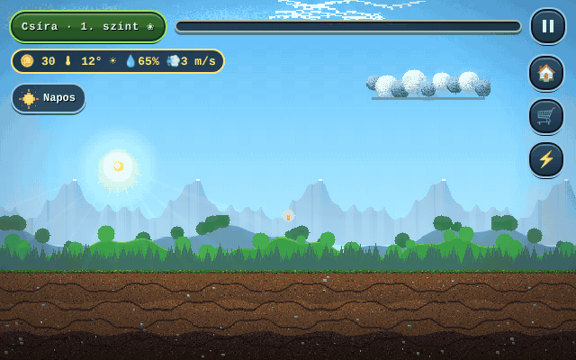
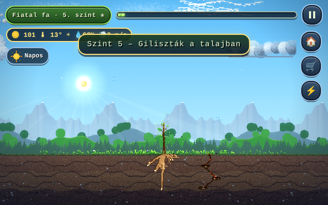
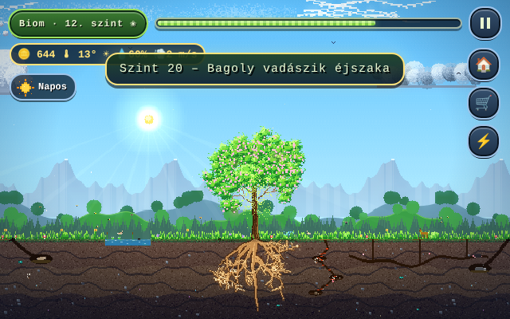

🇬🇧 English · [🇭🇺 Magyar](README.hu.md)

# 🌱 Feed&Seed

A calm retro pixel-art nature game: plant one seed, water it, and watch it grow into a tree, then a whole living forest with weather, seasons, animals and disasters.

<p align="center"></p>

<p align="center">
<a href="https://strattila90-hue.github.io/feed-seed/"><b>▶ Play now</b></a> &nbsp;·&nbsp;
<a href="https://github.com/strattila90-hue/feed-seed/releases/tag/latest"><b>📱 Download APK</b></a>
</p>

<p align="center">


</p>

The game UI is currently in Hungarian only; tapping and watching is all you need to get started.

## Features

- **Tap to plant, tap to water.** Trees grow through realistic stages (seedling, sapling, young and mature tree) with recursively branching crowns and a unique root system per tree.
- **A growing biome.** Flowers, mushrooms, ferns and bushes appear level by level; underground there are ant colonies, earthworms, grubs and moles. Later levels add a lake, butterflies, birds, fireflies, rabbits, frogs, bees, deer, owls and foxes.
- **Seasons and a day/night cycle.** Deciduous trees turn colour, drop their leaves, rest under snow and bloom again.
- **Simulated weather.** Air pressure, humidity, dew point, fog, wind and 11 real cloud types, with rain, snow, thunder, rainbows and shooting stars.
- **Disasters you can survive.** Storms, supercells, tornadoes, wildfires (extinguish by tapping), floods, drought, frost and locust swarms, each with adjustable intensity.
- **Market and many tree species.** Oaks, birches, pines, cherry blossom, Hungarian native trees, record-breaking giants (including Hyperion) and even a prehistoric Lepidodendron.
- **Endless, scrollable world** with a nature journal that tracks the creatures you have discovered.
- **Generative music** (WebAudio, no audio files), automatic saving and full offline support.
- Works on phones, tablets and desktop, portrait and landscape.

## Screenshots

<p align="center">


</p>

## Run locally

There is no build step and no dependencies for the game itself:

```bash
git clone https://github.com/strattila90-hue/feed-seed.git
cd feed-seed
python3 -m http.server 8000
```

Then open http://localhost:8000. Append `?debug` to the URL for an FPS and error overlay.

## Tech

- Vanilla JavaScript and a single HTML file (`index.html`) with canvas rendering, no framework.
- Installable PWA with a network-first service worker (`sw.js`) for offline play.
- Android APK built with [Capacitor](https://capacitorjs.com/) by GitHub Actions (`.github/workflows/build-apk.yml`).
- All sound is synthesised at runtime with WebAudio.

For the full (Hungarian) feature description, see [README.hu.md](README.hu.md).

## Contributing

Issues and pull requests are welcome, see [CONTRIBUTING.md](CONTRIBUTING.md). Look for issues labelled `good first issue`.

## License

[MIT](LICENSE) © 2026 strattila90-hue

---

⭐ If you like it, please give it a star — it really helps!
